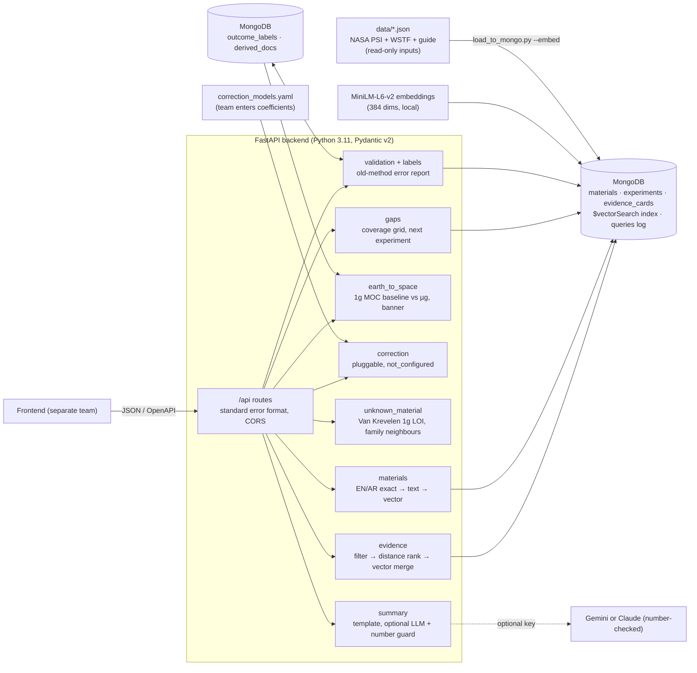

# Mission Lens — backend

**Team Orion · NASA Space Apps 2026 · "Flame in Freefall: AI-Powered Fire Safety Insights from Microgravity Combustion Data"**

Mission Lens is decision support for spacecraft and habitat fire-safety engineers. Pick a mission atmosphere (O2 %, pressure, gravity) and a material, and it answers:

> What does NASA's microgravity combustion data actually say about this material in these conditions, how wrong is the standard Earth test for this case, and what experiment is missing?

This repository is the **backend and API only**. The frontend is built separately against [`docs/API_CONTRACT.md`](docs/API_CONTRACT.md).

## Run it (3 commands)

```bash
cp .env.example .env
docker compose up --build        # MongoDB (atlas-local) + data loader + API; first start ≈ 3 min (downloads the embedding model)
open http://localhost:8000/docs  # Swagger UI; the API is at http://localhost:8000/api
```

The first start loads and embeds the 872 records and creates the vector index. Later starts skip that step.
No API key is needed. Frontend developers can also work **without any database**: `MOCK=1` serves `docs/examples/*.json`.

```bash
docker compose exec backend python -m pytest -q     # 110 tests
docker compose restart backend                      # after editing backend code (no auto-reload)
```

Port 27018 is used for MongoDB on the host (`MONGO_PORT` in `.env`); the API is on 8000.

## The rules this backend enforces

1. **No quote, no number.** Every number comes from a record (with `experiment_id`, `source_ref`, `doi`) or from a computed result whose inputs are shown. The optional LLM summary is checked number-by-number against the retrieved records; on any mismatch the deterministic template summary is used.
2. **Never invent data.** Missing values stay `null` ("not available"). No correction coefficients are shipped.
3. **Three labelled tiers:** `EVIDENCE` (green) · `MODEL_ESTIMATE` "Model estimate — not tested" (amber; a probability from a Bayesian model with its interval and its measured held-out error, only inside the oxygen/airflow range it was trained on) · `NO_DIRECT_EVIDENCE` (grey).
4. **Gravity domain:** data exists only for microgravity and 1g. Never interpolated. Moon and Mars always return `NO_DIRECT_EVIDENCE` plus the nearest µg and 1g evidence.
5. **No mixing of test types:** 1g MOC/ULOI (NASA-STD-6001 Test 1, upward) and LOI (downward, ASTM D2863) are separate quantities.
6. **Smoke/detection records** (SAME, `flammability_relevant = false`) are never burn evidence.
7. **Flags are shown** next to the values they affect; **every record has a source link** (DOI, or the NTRS URL for WSTF).

## Architecture



Repository layout:

```
data/                 the 5 read-only inputs; derived/ holds human labels and the validation report
backend/app/          api/routes.py · services/ · models/api.py (single source of truth) · core/config.py, correction_models.yaml
backend/scripts/      load_to_mongo.py · build_validation.py · import_labels.py · build_examples/export_live_examples.py · build_postman.py · build_provenance.py
backend/tests/        110 tests (contract, retrieval, earth-vs-space, labels, validation, LLM guard, latency)
docs/                 API_CONTRACT.md · examples/*.json · postman_collection.json · PROVENANCE.md
```

## API

OpenAPI at `/openapi.json`, Swagger at `/docs`, Postman collection in [`docs/postman_collection.json`](docs/postman_collection.json). Full contract with examples for every tier and empty state: [`docs/API_CONTRACT.md`](docs/API_CONTRACT.md).

| Endpoint | Purpose |
|---|---|
| `POST /api/assess` | Main endpoint: verdict, evidence groups, Earth-vs-Space, estimate, nearest evidence, findings, chart points, summary |
| `GET /api/demo-scenarios` | Ready-made `assess` requests: ISS cabin (PMMA, SIBAL), lunar habitat 34 % O2 (PET), unknown material on Mars |
| `GET /api/presets` · `/api/materials/search?q=` · `/api/materials/{id}` · `/api/materials/{id}/evidence` · `/api/experiments/{id}` | Catalog and provenance |
| `GET /api/coverage/{material_id}` · `/api/next-experiments?preset=` | Gap map and "suggested test" ranking |
| `GET /api/validation` · `GET /api/admin/labels/queue` · `POST /api/admin/labels` | Old-method error report and human labelling |
| `GET /api/experiments` · `POST /api/compare` · `POST /api/ask` | Frontend list, **compare agent** (comparability rules + limitations) and **ask agent** (guarded retrieval, citations) |
| `GET /api/about` · `/api/health` | Investigations, incidents, licenses · DB, vector index, embedding model |

Try it:

```bash
curl -s localhost:8000/api/demo-scenarios | python3 -c "import sys,json;print(json.dumps(json.load(sys.stdin)['scenarios'][0]['request']))" \
 | curl -s -X POST localhost:8000/api/assess -H 'content-type: application/json' -d @- | python3 -m json.tool | head -30
```

## Data provenance

Everything shown traces to a NASA record. Details, per-source counts, DOIs and licenses are generated into [`docs/PROVENANCE.md`](docs/PROVENANCE.md).

| Input | Content | Origin |
|---|---|---|
| `experiments.json` (872) | PSI experiment rows (BASS, BASS-II, Saffire-II/III, FLEX, SAME, ACME BRE, …) and WSTF 1g MOC/ULOI thresholds | NASA Physical Sciences Informatics (CC0-1.0, DOI per investigation) and NASA White Sands Test Facility, Hirsch et al. 2011 (NTRS 20110008636) |
| `evidence_cards.json` (872) | One text card per experiment, embedded for vector search | Derived from the experiment rows |
| `materials.json` (31) | Canonical materials, variants, ranges | Builder's grouping of the rows; Arabic names, aliases and chemical families are **search helpers, not NASA data** |
| `flame_in_freefall_knowledge.json` | 24 investigations, Researcher's Guide findings RG-01…RG-30, incidents, mission presets | NASA Researcher's Guide, PSI, NASA pages |
| `derived/link2018_experiments.json` (98) | PMMA rod flame-spread rates, ISS microgravity (Table S1) and normal gravity (Table S2), merged at load time | Link et al. 2018, Sci Rep 8:120, Supplemental Material (**CC BY 4.0**, attribution required), parsed by `backend/scripts/parse_link2018.py` from the raw PDF in `data/raw/` |
| `atlas_dataset.json` (669) | Labelled microgravity runs used only to train the burn-outcome model (real solids, 136 of them after the label filter) | `ai-engine` branch (commit 43030de): NASA PSI raw files, plus BASS-II report tables transcribed by the team; label method and weight stored per row |
| MongoDB `outcome_labels` | Human labels of BASS crew notes, each with its quote and labeller (one document per record; survives restarts and cloud deploys) | Team (human-confirmed only) |

Known caveats shown in the data and the API: FLEX burning-rate unit is uncertain (the string is shown as given); BASS-II, CFI, Saffire-III and FLEX-2 rows are `conditions_only` ("tested at", not results); some PMMA variants are "inferred from investigation context"; ACME O2 cells like "3400%" are spreadsheet artifacts kept raw and flagged; Link 2018 Tables S1/S2 are not loaded yet.

## How the verdict is decided

- **EVIDENCE**: at least one record with an outcome, same material, same gravity bucket, within ±1.5 % O2 and ±20 kPa (pressure compared only when the record states it). Tolerances are in config and returned in the response. For 1g MOC thresholds the O2 coordinate is the MOC value.
- **NO_DIRECT_EVIDENCE**: otherwise — and always for Moon/Mars and for unknown materials. Nearest µg and 1g evidence is shown instead.
- **MODEL_ESTIMATE**: (a) a configured correction model inside its `valid_range` with a measured error (none today); or (b) the burn-outcome model (`app/services/predictor.py`, Bayesian logistic regression on 136 labelled microgravity runs: NASA tables + crew-note rule) when there is no tested microgravity record and oxygen/airflow are inside the trained range. Materials the model has no data for get the prior material spread, so a wide interval. On held-out investigations it does **not** beat a constant guess, and the API says so.
- **Earth vs Space**: shows the 1g MOC range next to µg evidence. The red "1g test is NOT conservative" banner needs a **human-confirmed** `sustained_burn` label below the 1g MOC; with no confirmed labels the answer is "undetermined", never "conservative".

## Team workflows

**Label BASS crew notes** (what makes the validation report meaningful; 121 records):

```bash
docker compose exec backend python scripts/import_labels.py --export-queue /app/data/derived/queue.csv   # fill label, quote, labelled_by in a spreadsheet
docker compose exec backend python scripts/import_labels.py /app/data/derived/queue.csv                  # same rules as POST /api/admin/labels
docker compose exec backend python scripts/build_validation.py     # stores the result in MongoDB (derived_docs) and exports data/derived/validation.json + .md
```

`label` ∈ `sustained_burn · brief_then_self_extinguished · no_ignition · extinguished_by_flow_or_N2 · hardware_issue · unclear`; `quote` must be a verbatim span of the notes. Keyword suggestions are only hints and never count.

**Enter correction-model coefficients:** edit `backend/app/core/correction_models.yaml` (status `configured`, citation, page, equation, formula, inputs, coefficients, valid_range) from the paper, then run `build_validation.py` to measure the error. Outside `valid_range` the answer stays `NO_DIRECT_EVIDENCE`.

**Optional LLM phrasing** (assess summary, `/api/compare`, `/api/ask`): set `GEMINI_API_KEY` (free key from aistudio.google.com/apikey; model `gemini-2.5-flash`, `GEMINI_MODEL` to change) or `ANTHROPIC_API_KEY` (`LLM_MODEL`, default `claude-opus-5-5`). `LLM_PROVIDER=auto|anthropic|gemini` picks one. Every text is checked number-by-number against the records and falls back to the template on any mismatch. Not needed for anything else; `/api/health` shows which provider is active.

**Switching the embedding model** means re-embedding: change `EMBED_MODEL` and `EMBED_DIMS`, then `docker compose down -v` and `up` again.

**MongoDB Atlas instead of local:** set `MONGODB_URI` (and `MONGODB_DB`); run `python scripts/load_to_mongo.py --embed` once. The same code uses `$vectorSearch`.

## Limits to state at judging

- The old-method test can only evaluate materials with both a 1g MOC and BASS crew notes: PMMA and PEI today, so n is small. It reports a strict count (beyond every 1g MOC row) and a variant-dependent count (beyond some rows) separately.
- Nothing is known about gravity between 0 g and 1 g; Moon/Mars answers are directional only.
- Retrieval and verdicts are evidence lookups, not predictions. Suggested tests are suggestions, not results.
